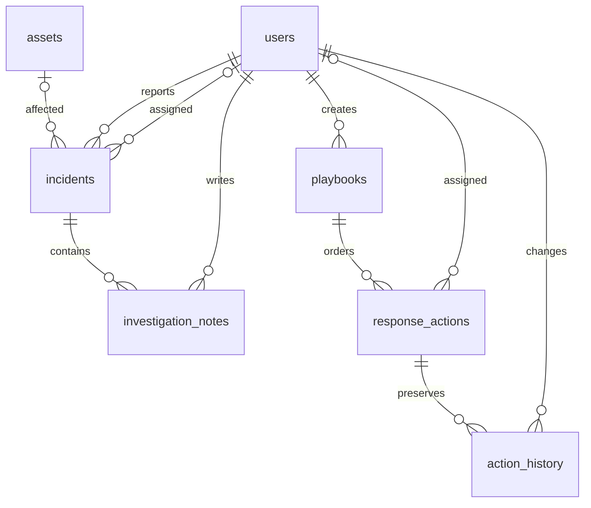

# Database design (Charbel Faddoul)

Part 3 uses external `common/schema.sql` unchanged. All connections come from common.db and enforce `PRAGMA foreign_keys=ON`. Startup calls common.make_app to initialize the complete shared schema. No personal database is packaged. Text timestamps are generated in UTC ISO 8601. All tables below have integer `id` primary keys.

| Table | Fields other than id | Relationships and decisions |
|---|---|---|
| incidents | title, description, category, severity, reporter_id, asset_id, assigned_analyst_id, status, creation_date, resolution_date | reporter_id -> users.id required; asset_id -> assets.id nullable in shared schema but required at creation by this API; assigned_analyst_id -> users.id nullable until assignment; lifecycle checked by service |
| investigation_notes | incident_id, analyst_id, note_content, creation_timestamp | required incident_id -> incidents.id; required analyst_id -> users.id; one incident has many notes; identity comes from verified caller |
| playbooks | name, description, incident_category, severity, created_by, creation_date | created_by -> users.id required; category and severity organize procedures |
| response_actions | playbook_id, description, step_number, status, assigned_user_id, completion_date | playbook_id -> playbooks.id ON DELETE CASCADE; assigned_user_id -> users.id nullable while Pending; UNIQUE(playbook_id,step_number), CHECK(step_number > 0) |
| action_history | action_id, status, assigned_user_id, changed_by, timestamp | action_id -> response_actions.id ON DELETE CASCADE; assigned_user_id -> users.id nullable; changed_by -> users.id required; initial snapshot and each change preserve execution history |

Reports have no owned table: their data comes from owning HTTP APIs. Physical FKs preserve links even though business lookups are HTTP. Logical user deletion in Part 2 preserves historical references. Incident notes do not cascade in the canonical schema, and there is no incident delete API. Playbook deletion cascades children/history by explicit contract and logs a separate deletion request. Service validation supplies enum/lifecycle rules missing from some canonical SQL columns; direct SQL writes are not a supported API. No schema strengthening is silently applied.

To capture real structure evidence after integration, inspect PRAGMA table_info, foreign_key_list, index_list and foreign_key_check in a DB viewer; capture actual records before/after API execution. Test databases are temporary and not submission evidence.
