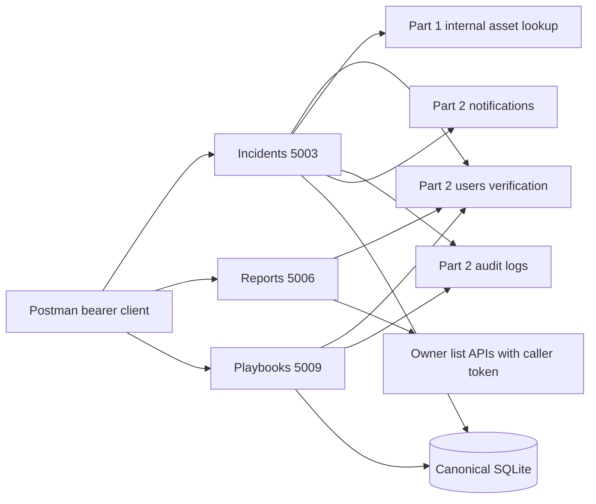

# Services 3, 6 and 9 (Charbel Faddoul)

## Purpose and architecture (Charbel Faddoul)

The backend supports incident investigation, evidence-based reporting and ordered response procedures. Three independent Flask processes share the canonical SQLite database and communicate with owners through HTTP. No frontend, Docker, ORM, background job or cloud is needed. `IncidentService`, `PlaybookService` and `ReportService` are small classes that organize record scoping, history and aggregation; routing stays in simple functions.

## Three APIs explained (Charbel Faddoul)

**Create incident:** `POST /charbel-faddoul/incidents` validates title, description, category, severity and asset ID. An employee's identity supplies the reporter; attempting to impersonate another reporter gives an audited 403. The service validates the asset through the internal asset API, records a validated audit request, then inserts an Open incident. Its 201 response includes the stored record and notes list. This avoids exposing public assets to employees.

**Advance incident:** `PUT /charbel-faddoul/incidents/{id}/status` permits an administrator or the assigned analyst. It accepts only the next state in Open -> Under Investigation -> Mitigated -> Resolved -> Closed. Resolution time is generated when entering Resolved and retained on Closed. A conditional SQL update detects concurrent assignment/status changes. This makes lifecycle rules observable and avoids skipped investigation.

**Advance response action:** `PUT /charbel-faddoul/actions/{id}/status` validates an Active assigned user and requires all earlier-numbered actions to be Completed. It permits Pending -> In Progress -> Completed and writes an execution snapshot in the same transaction. Completed steps cannot be silently rewritten. A two-step procedure can be demonstrated as: add step 1 Collect access evidence and step 2 Contain the affected account; show step 2 is blocked; start and complete step 1; start and complete step 2; retrieve the playbook with all history snapshots.

**Generate threat report:** `GET /charbel-faddoul/reports/threats` forwards the caller's bearer token to the threat owner, groups real returned records by severity/type and returns the latest 10 indicators. It never queries the threats table directly. Missing services cause an explicit error. The automated fixture test compares results with persisted records, but a real team-data comparison and screenshots remain pending.

## Permissions and validation (Charbel Faddoul)

Administrators create/read/assign/advance/note incidents; analysts access only assigned incidents; employees create and track only their own; auditors read. Unrestricted incident listing is admin/auditor-only; separate assigned/mine lists implement the overview. Playbooks permit admin creation/deletion, admin/analyst action management and admin/analyst/auditor reads. Employees have no playbook access. Reports allow only administrators/auditors.

Every protected route delegates identity verification to Part 2 through common.protected. Role headers are never trusted. Part 2 must reread current account status/role. Missing credentials, role denials and local ownership denials are audited. Part 2 must audit invalid token verification without recursion. Input rejects unknown fields, empty JSON, invalid types, severities, nonpositive/bool IDs and client timestamps. Strings are bounded and SQL values are parameterized. Errors use the shared status/error/message convention with 400, 401, 403, 404, 409 and 503 as documented in the API reference. If audit is unavailable, canonical behavior may return 503 even for a denied request.

## Transactions and interpretation decisions (Charbel Faddoul)

Audit writes occur before business transactions and say requested. This avoids deadlocking another service writing the same SQLite file. Assignment notifications happen after commit, with a warning if delivery fails. Investigation notes link to both incident and authenticated author. Administrator notes use the same analyst_id field to preserve the contract. Playbook steps are appended in increasing positive order; numbering gaps are allowed. History contains status/assigned-user snapshots, actor and UTC time; history is preserved until authorized parent deletion cascades it. No workflow scheduler or external response execution is claimed.

The supplied user helper cannot be read by analysts. Self-assignment works, but assigning/validating other users as an analyst requires a coordinated internal user lookup. Login action labels also need Part 2 agreement; activity reports require exact configured labels and otherwise return 503. These are explicit integration gaps, not implemented shared contract changes.

## Evidence and limitations (Charbel Faddoul)

Seven isolated tests passed on 17 October 2026. Real SQLite and real HTTP transport were used; missing teammate services were test doubles. These results are development validation only. No Postman execution screenshots, real authentication proof, all-nine-service integration or final common Word report is claimed. The evidence checklist maps every owned Implementation Evidence Requirement to work still needed on the assembled system. JSON reports are sufficient; PDF generation is outside scope.

## References and AI disclosure (Charbel Faddoul)

Assignment source: supplied *Final Project: Software Tools Lab, Security Incident Detection and Response Management System Backend, Sprint I Tasks*. Integration sources: supplied TEAM_CONTRACT.md, common/runtime.py, common/schema.sql, team_config.json and repository.json. Library reference locations for student review: [Flask documentation](https://flask.palletsprojects.com/), [Python sqlite3 documentation](https://docs.python.org/3/library/sqlite3.html), [Requests documentation](https://requests.readthedocs.io/), [Postman Collection v2.1 schema](https://schema.getpostman.com/json/collection/v2.1.0/collection.json). These links are reference locations, not a claim of having browsed them during development.

OpenAI Codex assisted in interpreting requirements, drafting Part 3 code, test fixtures, Postman artifacts and documentation, and running local checks. Charbel must review, adapt, understand and explain the draft; student review and instructor approval are not asserted. The brief prohibits copying complete AI-generated solutions. Verify the instructor's permitted assistance scope before submission and disclose the actual assistance. No screenshots, login evidence, measured results or Git history were fabricated. Team members must themselves attend the required CREATES coaching session and apply feedback; no booking or attendance is claimed.
